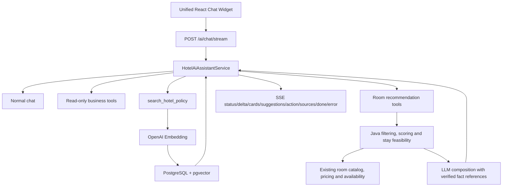

# 09. AI Integration

# HANBAY HOTEL
## Spring AI Integration Design

---

# 1. AI Goals

AI is used as an assistant, not as the main booking engine.

AI features:

- Unified Hotel AI Assistant
- Booking Summary
- Admin Insight Summary

---

# 2. AI Room Recommendation

Chức năng hiện dùng engine Java để lọc điều kiện bắt buộc, kiểm tra khả thi lịch phòng và xếp hạng tối đa ba room type. Widget dùng một luồng chat với `recommend_rooms`, `inspect_recommended_room`, `compare_recommended_rooms`, `select_recommended_room`. Trợ lý nhớ thứ tự phòng, hỏi bổ sung và phát nút checkout sau khi khách chọn và backend kiểm tra lại; không còn tab form riêng. `POST /api/v1/room-recommendations` giữ vai trò API engine có cấu trúc. Giá/ảnh/giường/amenities và thẻ kết quả do backend cung cấp. Xem [thiết kế và contract triển khai](33-ai-room-recommendation.md) cho ngân sách, scoring, Redis context và giới hạn một phòng mỗi phương án.

Ví dụ hội thoại trong catalog kiểm thử (giá minh họa do Java trả, không phải cam kết giá thực tế):

```text
Khách: Gia đình mình muốn đi nghỉ, bạn tư vấn giúp nhé.
AI: Bạn dự định nhận/trả ngày nào và có bao nhiêu người lớn, trẻ em đi cùng?
Khách: 01–03/12/2026, hai người lớn và một bé 5 tuổi, đúng hai giường đơn,
       tổng tiền phòng không vượt 6 triệu, ưu tiên phòng rộng.
Backend: Kiểm tra ngày/sức chứa/giường/ngân sách/tồn và xếp hạng:
         Deluxe Twin 36 m², tổng 5.000.000 VND; Superior Twin 30 m², tổng 3.400.000 VND.
AI: Giới thiệu hai phương án từ facts và nói rõ đánh đổi về diện tích.
Khách: So sánh hai phòng đó giúp mình.
Backend: Refresh cả hai, tính chênh lệch 1.600.000 VND và 6 m².
Khách: Phòng thứ hai có giường và tiện nghi gì?
AI: Resolve phòng thứ hai theo danh sách đã hiển thị, lấy dữ kiện mới từ engine.
Khách: Mình chọn phòng này.
Backend: Kiểm tra lại phòng đang nhắc tới, phát nút tiếp tục đặt phòng.
```

Chưa đủ dữ liệu thì hỏi bổ sung; không kết luận giá hay tồn. “Yên tĩnh tuyệt đối” hoặc đặc điểm chưa có dữ liệu được hỏi làm rõ, không bịa xác nhận. JSON tool arguments, câu trả lời LLM và payload thẻ là các contract riêng; xem tài liệu triển khai được dẫn ở trên.

---

# 3. Policy RAG inside Unified Chat

User questions:

```text
Can I cancel my booking?
What time is check-in?
Are pets allowed?
```

AI answers based on predefined hotel policies.

Policy search là tool nội bộ của unified assistant, không phải assistant/endpoint độc lập:
canonical Markdown được chunk theo section, embedded bằng OpenAI `text-embedding-3-small`
(1536 chiều), persist trong PostgreSQL/pgvector qua Spring AI `PgVectorStore`, rồi semantic-retrieve
bằng cosine similarity trước khi gọi chat model.

---

# 4. Architecture



---

# 5. Prompt Strategy

The system prompt should:

- Keep answer short and clear.
- Use only hotel data provided by backend.
- Avoid making unsupported claims.
- Recommend user to contact receptionist when uncertain.

---

# 6. Spring AI Components

- ChatClient
- PromptTemplate
- Structured Output
- AI Request Logging

## Function Calling API

Backend exposes authenticated endpoints. The frontend uses the SSE endpoint for progress updates and validated answer paragraphs:

```http
POST /api/v1/ai/chat/stream
Authorization: Bearer <access-token>
Accept: text/event-stream
Content-Type: application/json
```

The stream emits `status`, `delta`, `action`, `sources`, `recommendations`, `suggestions`, `done`, or `error` events. Đây là conversational
endpoint duy nhất. AI concierge là floating widget duy nhất; unauthenticated users được yêu cầu
đăng nhập. Frontend chuẩn hóa malformed, empty và partial stream thành application error.

Room recommendation phát thẻ từ payload `recommendations` của backend; `suggestions` gửi câu hỏi tiếp vào cùng phiên. `status` phản ánh tiến độ trước khi phát đoạn trả lời đã kiểm tra. API engine có cấu trúc không phải conversational endpoint mới và không phụ thuộc OpenAI.

Production Policy RAG dùng OpenAI embedding và cần các biến môi trường sau. Local mặc định tắt RAG
(`AI_POLICY_RAG_ENABLED=false`); policy tool trả no-evidence an toàn, không dùng fake embedding:

```text
AI_POLICY_RAG_ENABLED=true
AI_EMBEDDING_MODEL=openai
OPENAI_API_KEY=<secret>
OPENAI_EMBEDDING_MODEL=text-embedding-3-small
OPENAI_EMBEDDING_DIMENSIONS=1536
```

Available read-only tools:

- `search_available_rooms`
- `calculate_stay_price`
- `get_room_type_details`
- `list_active_addons`
- `get_my_bookings`
- `get_booking_details`
- `get_payment_status`
- `check_cancellation_eligibility`

Booking and payment tools use the authenticated user's security context. The model cannot supply a user ID or booking access token.
`search_hotel_policy` coi mọi retrieved content là untrusted reference data; embedded instructions
không được thực thi. Khi không có evidence, model phải trả lời không tìm thấy policy thay vì dùng
kiến thức nền.

---

# 7. AI Request Logging

Table:

```text
ai_requests
- id
- user_id
- feature
- prompt (`[REDACTED]`)
- response (`NULL`)
- created_at
```

Purpose:

- Track success/failure, feature and duration without persisting raw user/provider content

---

# 8. Limitations

- AI does not create booking automatically.
- AI does not process payment.
- AI does not override hotel policy.
- AI answers are advisory only.

---

# 9. Future Enhancements

- Đánh giá/tuning threshold bằng tập câu hỏi production lớn hơn corpus demo
- Review summary
- Revenue insight assistant
- Multilingual support
