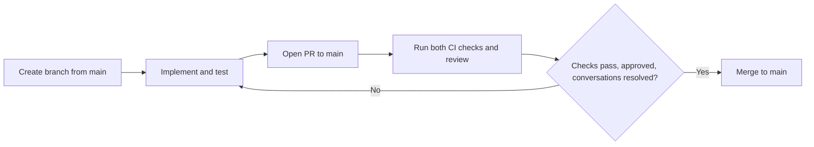

# 13. Git Workflow

## 1. Branch strategy

The two-member team uses trunk-based development with `main` as the only
long-lived branch. A separate `develop` branch is not used.

```text
feat/*  ─┐
fix/*   ─┤
test/*  ─┼─ Pull Request ─ review + CI ─> main
docs/*  ─┤
chore/* ─┘
```

Allowed branch prefixes:

| Prefix | Purpose | Example |
| --- | --- | --- |
| `feat` | New functionality | `feat/HAN-101-authentication` |
| `fix` | Bug fix | `fix/HAN-120-payment-status` |
| `test` | Test-only changes | `test/HAN-130-booking-security` |
| `docs` | Documentation-only changes | `docs/HAN-140-api-contract` |
| `chore` | Maintenance, build, CI or refactoring | `chore/HAN-150-update-ci` |

Use lowercase kebab-case after the Jira key. Keep one branch focused on one
issue. Do not create `develop`, `feature/*`, `bugfix/*`, `refactor/*` or
`hotfix/*` branches.

## 2. Start work

Create every working branch from the latest `main`:

```bash
git switch main
git pull --rebase origin main
git switch -c feat/HAN-101-authentication
```

Do not commit or push directly to `main`.

## 3. Commit convention

Use Conventional Commits and include the Jira key:

```text
<type>(<scope>): <jira-key> <short-description>
```

Examples:

```text
feat(auth): HAN-101 add JWT authentication
fix(payment): HAN-120 correct payment status mapping
test(booking): HAN-130 cover booking authorization
docs(api): HAN-140 document booking contract
chore(ci): HAN-150 update GitHub Actions triggers
```

## 4. Pull request flow



Before opening a PR:

```bash
git fetch origin
git rebase origin/main
git push -u origin feat/HAN-101-authentication
```

Every PR must:

- target `main`;
- use an allowed branch prefix;
- receive at least one approval;
- pass the required `Backend CI` and `Frontend CI` checks;
- resolve all review conversations;
- contain no unrelated changes or secrets.

Squash merge is recommended for a concise `main` history.

## 5. `main` branch protection

Configure the `main` branch rule in GitHub with:

- Require a pull request before merging.
- Require 1 approving review.
- Require status checks `Backend CI` and `Frontend CI` to pass.
- Require branches to be up to date before merging.
- Require conversation resolution before merging.
- Include administrators so the rule cannot be casually bypassed.
- Do not allow force pushes.
- Do not allow deletions.

The repository includes
[`scripts/configure-main-protection.sh`](../scripts/configure-main-protection.sh)
to apply this rule through the GitHub REST API. The caller needs a fine-grained
token with repository Administration permission set to read and write:

```bash
GH_TOKEN=<token> ./scripts/configure-main-protection.sh
```

The token must only be provided through the environment and must never be
committed.

## 6. CI trigger policy

Both workflows run for every pull request targeting `main` and for every push
to `main`. They intentionally do not use path filters because both checks are
required by branch protection; skipping a workflow would otherwise leave its
required check pending.

## 7. Resolve conflicts

Rebase the working branch onto the latest `main`:

```bash
git fetch origin
git rebase origin/main
# resolve conflicts
git add <resolved-files>
git rebase --continue
git push --force-with-lease
```

After review has started, tell the reviewer before rewriting branch history.
