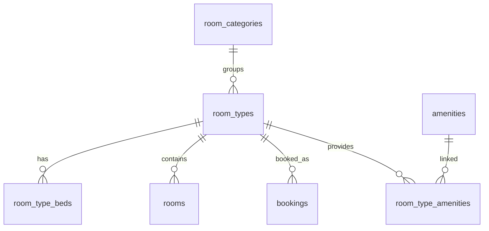

# Mô hình phòng HANBAY

Mô hình hiện hành gồm 6 nhóm, 8 Room Type đặt riêng và 35 phòng vật lý. Danh mục, sức chứa, giá mẫu, phân bổ phòng và quy trình reset được mô tả trong [room-type-catalog.md](data/room-type-catalog.md).



## Trách nhiệm từng phần

- Category quản lý nhóm hiển thị. Room Type là đơn vị đặt phòng, tính giá và quản lý tồn. Room là phòng vật lý thuộc đúng một Room Type.
- Giường lưu riêng trong room_type_beds: SINGLE, DOUBLE, QUEEN, KING và quantity dương. Unique (room_type_id, bed_type) chống dòng trùng. Twin là cách bố trí 2 SINGLE; Triple Mixed là 1 QUEEN + 1 SINGLE.
- Sức chứa giữ nguyên chính sách canAccommodate: giới hạn riêng người lớn, trẻ em và tổng maxGuests. Không suy sức chứa theo giường và không thêm trường sức chứa tiêu chuẩn.
- Diện tích ở area_m2. Hướng nhìn (COURTYARD, CITY, SEA), ban công và tầng cao ở các thuộc tính riêng, không gộp vào amenities.
- Amenities là tiện nghi có sẵn. Add-on services là dịch vụ mua thêm. Không có nghiệp vụ giường phụ.

## API và quản trị

MANAGER quản lý category qua GET/POST/PUT `/api/v1/management/room-categories`. Room Type sử dụng API quản trị hiện có, nhận thêm categoryId, beds, viewType, hasBalcony, highFloor.

Ví dụ phần cấu hình của Triple Mixed:

```json
{
  "categoryId": "<UUID nhóm Triple>",
  "beds": [{ "bedType": "QUEEN", "quantity": 1 }, { "bedType": "SINGLE", "quantity": 1 }],
  "maxGuests": 3,
  "capacityAdults": 3,
  "capacityChildren": 0,
  "areaM2": 38,
  "viewType": "CITY",
  "hasBalcony": false,
  "highFloor": true
}
```

Tạo Room Type cần chọn nhóm và ít nhất một cấu hình giường. Form cho thêm/bỏ từng dòng, chọn loại bằng dropdown, nhập số lượng và chặn chọn trùng. Sức chứa không tự đổi khi chọn giường.

API danh mục, chi tiết, tìm phòng khả dụng và quản trị trả cùng category, beds, bedConfigurationStatus và đặc điểm phòng. Chi tiết trả thêm areaM2 để hiển thị diện tích.

bedType là chuỗi tương thích sinh từ beds. Với dữ liệu cũ chưa cấu hình, giữ nguyên chuỗi hoặc null, beds rỗng và UNCONFIGURED; không parse tên phòng/chuỗi cũ để đoán giường. PUT bỏ beds/category/đặc điểm sẽ giữ nguyên giá trị hiện có. Các đặc điểm nullable biểu thị chưa khai báo; false là không có.

DELETE Room Type chuyển sang INACTIVE, giữ dữ liệu tham chiếu. Thao tác xóa dữ liệu demo chỉ có trong script reset local được chạy chủ động.

## Lịch sử và tồn phòng

Quản trị khóa Room Type bằng findByIdForUpdate, cùng khóa với tạo booking. Thay cấu hình giường hoặc chuỗi mô tả cũ sau khi đã có bất kỳ booking nào trả 409 ROOM_TYPE_BEDS_LOCKED, kể cả booking đã hủy/hết hạn/hoàn tất. Gửi lại cùng cấu hình được chấp nhận. Muốn kinh doanh cấu hình khác sau booking cần tạo Room Type mới.

RoomAvailabilityCalculator và các luồng booking/pricing/payment/check-in giữ nguyên cơ chế. Tồn lấy từ rooms, trừ nhu cầu booking theo từng đêm; không join giường để đếm và không coi một giường là một phòng. Snapshot/phiên bản giường trong booking là hướng mở rộng riêng, chưa triển khai.

## Migration và dữ liệu

- 202611071000 tạo category và cấu hình giường; giữ tương thích dữ liệu cũ.
- 202611071500 là migration lịch sử của bộ mẫu cũ đã áp dụng; giữ nguyên checksum.
- 202611071600 bổ sung view_type, has_balcony, high_floor, không suy luận giá trị cho loại cũ.
- scripts/reset-room-catalog.sql xóa dữ liệu phòng và tham chiếu theo yêu cầu reset local, rồi tạo đúng 6 nhóm/8 loại/35 phòng. Không tự chạy reset khi ứng dụng khởi động.

`V202611071700` thêm tuổi trẻ em nullable và đơn vị dịch vụ có snapshot. Family mẫu được
tăng giới hạn trẻ em lên 2, tổng vẫn 4. `V202611071800` định nghĩa nguồn seed duy nhất;
initializer local mới chỉ chuyển bộ demo lịch sử nguyên trạng/chưa giao dịch. Không sửa
các migration đã áp dụng 1000/1500/1600. Giảm capacity dùng khóa Room Type và chặn booking
đang ở/sắp tới vượt giới hạn mới. Bộ lọc đặc điểm xử lý cả true/false/unknown trước phân trang.

Các test gồm validation/đồng nhất API, bảo toàn lịch sử và khóa đồng thời, script reset với quan hệ booking/thanh toán/bảo trì, giữ tài khoản, rollback khi sai dữ liệu, và tìm phòng thực tế theo đủ 35 phòng vật lý. Test giao diện dùng Ant Design/React Query thật với API giả lập. PostgreSQL tests dùng container riêng.

```sh
# backend
./mvnw -o clean verify
# frontend
npm run test:run
npm run build
```
