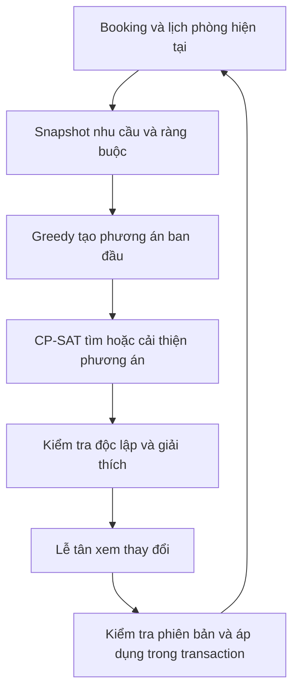

# Đề xuất chức năng gán phòng và tối ưu lịch phòng

Ngày soạn: **24/11/2026**. Nhánh: `feat/room-assignment-optimization`.

**Trạng thái: đã được duyệt và triển khai trên nhánh nêu trên; chưa phát hành.**
Cập nhật triển khai: 25/11/2026. Hợp đồng API, cấu hình và cách kiểm thử:
[hướng dẫn Lịch gán phòng](testing/room-assignment.md).

## 1. Hướng đề xuất để duyệt

Xây dựng **Lịch gán phòng** cho lễ tân và quản lý: xem booking trên lịch từng phòng,
nhận gợi ý xếp phòng, xem các thay đổi rồi chủ động áp dụng. Mục tiêu là giảm khoảng
trống ngắn, giữ lịch ổn định và bảo đảm mỗi khách ở một phòng suốt kỳ lưu trú.

| Nội dung | Phương án đề xuất cho phiên bản đầu |
| --- | --- |
| Thuật toán | Greedy tạo phương án ban đầu; CP-SAT tìm phương án khả thi và cải thiện chất lượng |
| Công nghệ | OR-Tools Java trong backend Spring Boot hiện tại; chưa tách dịch vụ Python |
| Phạm vi | Gán đúng `RoomType`, từng booking con của đơn nhiều phòng |
| Cửa sổ | Mặc định 60 ngày, cho chọn 30/60/90 ngày; kiểm tra cả phần kỳ ở vượt cửa sổ |
| Quyền quyết định | Hệ thống tạo gợi ý; lễ tân/quản lý xem thay đổi và bấm áp dụng |
| Giữ lịch ổn định | Không tự đổi phòng đã khóa, đã check-in hoặc đã được gán trong vùng đóng băng |
| Vùng đóng băng | Booking đã gán có ngày nhận hôm nay hoặc ngày mai, theo giờ khách sạn |
| Nhận booking mới | Đếm tồn theo đêm; thêm kiểm tra khả năng xếp khi có ràng buộc phòng cụ thể |
| Tối ưu tự động | Sự kiện nghiệp vụ và tác vụ ban đêm tạo bản gợi ý, chưa tự áp dụng |
| Phần để sau | Upgrade, ở nhiều phòng trong một kỳ, phòng liền kề, tầng/VIP và tự động áp dụng |

Đây là phạm vi MVP đã được duyệt. Trọng số tối ưu vẫn cần được đánh giá bằng dữ
liệu vận hành trước khi điều chỉnh.

## 2. Hiện trạng đã đối chiếu với repository

| Thành phần | Hiện trạng | Hướng tích hợp |
| --- | --- | --- |
| `RoomAvailabilityCalculator` | Lấy số phòng bán được trừ nhu cầu cao nhất theo từng đêm | Tái sử dụng cho bước kiểm tra tồn |
| `BookingRepository` | Tính nhu cầu `CONFIRMED`, `CHECKED_IN`, `PENDING` chưa hết hạn; xử lý khách ở quá hạn | Dùng cùng tập booking cho bộ lập lịch |
| `CheckInServiceImpl` | Lễ tân chọn phòng `AVAILABLE`, đúng loại; khóa booking/phòng và kiểm tra xung đột khi check-in | Điền sẵn phòng đã gán, kiểm tra lại trước khi nhận khách |
| `Booking.assignedRoom` | Được thiết lập khi check-in; các luồng hủy/no-show có xử lý bỏ gán | Giữ ý nghĩa phòng thực tế; tạo lớp gán dự kiến riêng |
| `Booking.stayRevision` | Đã có phiên bản kỳ lưu trú | Tham gia kiểm tra dữ liệu; chưa thay thế được phiên bản toàn lịch |
| `Room.status` | Trạng thái vận hành hiện tại: sẵn sàng, đang ở, bẩn, đang dọn, bảo trì, ngừng phục vụ | Không dùng làm trạng thái gán dự kiến |
| `MaintenanceRequest` | Có thời điểm thực hiện, chưa có khoảng bảo trì tương lai dành cho bộ lập lịch | MVP chặn phòng đang bảo trì; lịch bảo trì tương lai là phần mở rộng |
| Sơ đồ tầng và danh sách đến hôm nay | Đã có màn hình cho nhân viên | Thêm liên kết mở lịch và gợi ý phòng từ các màn hình này |

Phòng `OCCUPIED`, `DIRTY`, `CLEANING` vẫn thuộc tồn có thể bán cho kỳ ở tương lai.
Phòng được gán dự kiến không chuyển sang `OCCUPIED`; chỉ check-in thực tế mới đổi
trạng thái này. Khi nhận khách, phòng vẫn phải sẵn sàng theo quy trình hiện có.

Nguồn nội bộ:
[tính tồn](../hotel-booking/src/main/java/com/hanbay/hotel/room/service/RoomAvailabilityCalculator.java),
[truy vấn booking](../hotel-booking/src/main/java/com/hanbay/hotel/booking/repository/BookingRepository.java),
[check-in](../hotel-booking/src/main/java/com/hanbay/hotel/booking/service/impl/CheckInServiceImpl.java),
[booking](../hotel-booking/src/main/java/com/hanbay/hotel/booking/domain/Booking.java),
[bảo trì](../hotel-booking/src/main/java/com/hanbay/hotel/maintenance/domain/MaintenanceRequest.java),
[thiết kế đồng thời](08-concurrency-design.md).

## 3. Điều kiện toán học cần giữ đúng

Khi các phòng cùng loại thay thế hoàn toàn cho nhau, có cùng khả năng phục vụ trong
toàn bộ kỳ xét, mọi booking được phép gán lại và không cho đổi phòng giữa kỳ, bài
toán là phân hoạch khoảng thời gian. Số phòng cần bằng số booking đồng thời lớn nhất.
Greedy duyệt theo ngày bắt đầu tìm được cách xếp đạt giới hạn này.
Nguồn: [bài giảng Interval Partitioning của Princeton](https://www.cs.princeton.edu/courses/archive/spring13/cos423/lectures/04GreedyAlgorithmsI.pdf).

**Khi xuất hiện phòng cố định, kiểm tra tồn theo đêm chỉ là điều kiện cần.**
Ví dụ hai phòng cùng loại, các ngày dưới đây đều thuộc tháng 12/2026:

| Booking | Khoảng ở, không gồm ngày trả | Điều kiện |
| --- | --- | --- |
| A | 01 → 02 | Khóa phòng 201 |
| B | 02 → 03 | Khóa phòng 202 |
| C | 01 → 03 | Cần một phòng liên tục |

Mỗi đêm chỉ có hai booking, nhưng C không thể ở liên tục tại 201 hoặc 202. Nếu
được bỏ khóa và xếp A, B cùng phòng 201 thì C có thể ở phòng 202. Bảo trì theo
khoảng ngày và yêu cầu bắt buộc về một nhóm phòng cũng có thể tạo hạn chế tương tự.

Hệ quả cho sản phẩm:

- Trường hợp thuần cùng loại, không có hạn chế phòng cụ thể: đếm tồn đủ để quyết định.
- Có phòng khóa/đang ở/vùng đóng băng hoặc phòng không khả dụng: kiểm tra thêm
  khả năng xếp toàn bộ nhu cầu bị ảnh hưởng trước khi cam kết giữ chỗ.
- Không tự mở khóa để nhận thêm khách. Nếu không xếp được, chỉ rõ hạn chế liên
  quan và để nhân viên có quyền xem xét phương án khác.
- Greedy thất bại không chứng minh vô nghiệm. Solver hết thời gian cũng không
  chứng minh vô nghiệm. Không cam kết mọi bộ dữ liệu đều giải xong trong 5 giây.

## 4. Trải nghiệm của lễ tân

Thêm mục **Lịch gán phòng** trong khu vực lễ tân, dùng chung cho quản lý. Sơ đồ
tầng tiếp tục thể hiện không gian; lịch gán phòng thể hiện phòng theo ngày.

1. Chọn loại phòng và khoảng thời gian. Mỗi hàng là một phòng, mỗi cột là một
   ngày; thanh booking kéo từ ngày nhận đến trước ngày trả.
2. Xem nhãn **Dự kiến**, **Đã khóa**, **Đang ở**, cùng trạng thái vận hành riêng.
   Booking chưa gán nằm trong danh sách bên cạnh; đơn nhiều phòng hiện từng phòng con.
3. Bấm **Gợi ý xếp phòng**. Hệ thống giữ các ràng buộc cố định và tính phương án.
4. Xem bảng so sánh: booking nào được gán mới, booking nào đổi phòng, lý do,
   số khoảng trống 1/2 đêm trước và sau, cảnh báo phòng chưa sẵn sàng.
5. Bấm **Áp dụng phương án**. Nếu lịch đã thay đổi, hiển thị
   “Lịch đã cập nhật, vui lòng lấy gợi ý mới”.
6. Khi khách đến, màn check-in điền sẵn phòng dự kiến. Lễ tân kiểm tra trạng thái
   thực tế rồi nhận khách theo quy trình hiện tại.

Phiên bản đầu dùng hộp thoại chọn phòng để gán thủ công. Kéo thả có thể bổ sung
sau, vì cả hai thao tác đều phải qua cùng bước kiểm tra và xem ảnh hưởng.

Ví dụ lý do hiển thị, chỉ sinh khi đúng với dữ liệu của phương án:

- “Phòng 201 có khách trả ngày 03/12, khớp ngày nhận của booking này.”
- “Giảm khoảng trống 1 đêm ở phòng 202.”
- “Giữ phòng 203 trống liên tục 4 đêm, từ 01 đến trước 05/12.”
- “Giữ nguyên phòng do booking đã khóa.”

Không dùng LLM để chọn phòng hoặc sinh một lý do không kiểm chứng được.

### Quyền và thao tác ngoại lệ

| Thao tác | Lễ tân | Quản lý |
| --- | --- | --- |
| Xem lịch, tạo gợi ý, áp dụng phương án hợp lệ | Có | Có |
| Gán thủ công/khóa phòng cho booking chưa ở | Có | Có |
| Mở khóa hoặc đổi phòng đã gán trong vùng đóng băng | Không | Có, bắt buộc lý do |
| Đổi phòng khách đã check-in bằng bộ tối ưu | Không | Không; cần quy trình chuyển phòng riêng |
| Thực hiện check-in | Theo quyền hiện có | Giữ quy định hiện tại, không tự mở rộng quyền |

Khóa thủ công có ý nghĩa cam kết phòng cụ thể. Vùng đóng băng chỉ ngăn tự đổi
phòng đã gán; booking mới chưa có phòng trong hôm nay/ngày mai vẫn được xếp vào
phòng phù hợp. Hủy, hết hạn hoặc xác nhận no-show giải phóng gán theo nghiệp vụ.

## 5. Kiến trúc và thuật toán

Đề xuất đặt module gán phòng trong backend Java 17 hiện có. OR-Tools có gói Java
qua Maven; tích hợp trực tiếp giúp dùng chung nghiệp vụ và tránh thêm một dịch vụ
Python trong MVP. Đây là lựa chọn kiến trúc đề nghị; cần xác minh thư viện native
trên Docker Linux và môi trường phát triển khi triển khai.
Nguồn: [OR-Tools for Java](https://developers.google.com/optimization/install/java).

### Greedy: baseline và phương án dự phòng

- Xử lý riêng từng loại phòng khi chưa có upgrade.
- Đặt các booking cố định và khoảng phòng bị chặn vào lịch trước.
- Duyệt các booking còn lại theo ngày nhận tăng dần, dùng mã booking làm thứ tự
  phụ để kết quả có thể lặp lại.
- Chỉ chọn phòng trống **toàn bộ kỳ ở**, kể cả các booking cố định trong tương lai.
  Ưu tiên ngày trả của booking trước gần nhất với ngày nhận; hòa thì ưu tiên giữ
  phòng hiện tại, rồi số phòng.
- Greedy dựng lại toàn bộ lịch có bảo đảm khả thi trong trường hợp thuần ở mục 3.
  Khi thêm khóa/vùng đóng băng, đây là heuristic và có thể thất bại dù vẫn có lời giải.
- Chỉ dùng kết quả dự phòng đã qua kiểm tra đầy đủ. Không ghi phương án thiếu
  booking hoặc vi phạm ràng buộc để vượt qua lỗi solver.

### CP-SAT: tính khả thi và tối ưu

Biến quyết định biểu diễn một booking vào một phòng đủ điều kiện. Mỗi booking
phải có đúng một phòng; mỗi phòng có các khoảng lưu trú không chồng lấn. Có thể
mô hình hóa bằng interval tùy chọn và `NoOverlap`; tài liệu OR-Tools minh họa các
ràng buộc lịch và có ví dụ Java.
Nguồn: [OR-Tools scheduling](https://developers.google.com/optimization/scheduling/job_shop).

Ràng buộc cứng của MVP:

- Đúng loại phòng, một phòng liên tục cho cả kỳ ở; không tự bỏ booking để làm đẹp lịch.
- Không trùng booking khác hoặc khoảng phòng bị chặn.
- Giữ nguyên phòng đã khóa, đã check-in và các gán thuộc vùng đóng băng.
- Xét `CONFIRMED`, `CHECKED_IN` và `PENDING` còn giữ chỗ. Booking pending có
  biến tạm phục vụ kiểm tra khả thi, chưa được công bố một số phòng cụ thể.
- Khách ở quá hạn tiếp tục chặn theo `HotelStayPolicy`; không coi ngày trả dự
  kiến đã qua là bằng chứng phòng đã được giải phóng.
- Phòng bảo trì/ngừng phục vụ hiện tại bị loại khỏi khả năng bán như chính sách
  hiện có. Không giả định ngày sửa xong khi dữ liệu chưa có.

Hàm mục tiêu ban đầu đề nghị: **10 × số khoảng trống 1 đêm + 4 × số khoảng trống
2 đêm + 3 × số booking đổi phòng**. Các trọng số là cấu hình thử nghiệm cần đánh
giá lại, không phải tỷ lệ tối ưu đã được chứng minh cho khách sạn.

Một lần đổi là thay phòng dự kiến của booking chưa ở, không phải chuyển khách
đang lưu trú. Khoảng trống 1/2 đêm chỉ tính khi nằm giữa hai kỳ ở trong cùng phòng,
đủ dữ liệu hai đầu và có thể bán; không tính ngày bảo trì hoặc phần ngoài cửa sổ
là khoảng trống. Chưa thêm thưởng khoảng trống dài vào MVP để tránh mục tiêu
chồng chéo; vẫn đo số cửa sổ đủ bán kỳ ở 3/5/7 đêm.

Giới hạn CP-SAT đề nghị 5 giây mỗi lần tối ưu tương tác; dùng phương án hợp lệ
hiện tại hoặc greedy làm gợi ý ban đầu. Nhãn kết quả phải phân biệt:

| Kết quả | Cách xử lý |
| --- | --- |
| `OPTIMAL` | Có lời giải tối ưu theo mô hình và trọng số đang dùng |
| `FEASIBLE` | Có lời giải hợp lệ; cho xem và áp dụng, chưa chứng minh tối ưu |
| `INFEASIBLE` | Đã chứng minh không xếp được với các ràng buộc hiện tại; giữ lịch cũ |
| `UNKNOWN` | Chưa kết luận; dùng phương án dự phòng hợp lệ nếu có, nếu không thì yêu cầu xử lý tiếp |
| `MODEL_INVALID` hoặc lỗi hệ thống | Ghi lỗi kỹ thuật; chỉ cho dùng phương án dự phòng đã kiểm tra |

Ý nghĩa các trạng thái theo [tài liệu CP-SAT](https://developers.google.com/optimization/cp/cp_solver).
Thông báo xung đột phải dựa trên kiểm tra thực tế; không hứa tìm được tập nguyên
nhân nhỏ nhất khi solver chưa cung cấp bằng chứng tương ứng.

## 6. Cửa sổ lịch và việc nhận booking mới

Cửa sổ 30–90 ngày là phạm vi xem và tối ưu, **không phải giới hạn kiểm tra xung
đột**. Phải lấy booking bắt đầu trước cửa sổ nhưng vẫn đang ở, toàn bộ kỳ ở của
booking kéo dài qua cuối cửa sổ và các ràng buộc liên quan. Nếu thay đổi lan sang
booking ngoài phạm vi thì mở rộng bài toán hoặc giữ booking đó cố định. Không
cắt kỳ ở tại ngày thứ 60 rồi kết luận an toàn cho phần còn lại.

Khi nhận booking mới hoặc duyệt đổi ngày/gia hạn:

1. Kiểm tra tồn theo đêm bằng quy tắc hiện tại, tính cả pending chưa hết hạn.
2. Khi có ràng buộc phòng cụ thể, kiểm tra khả thi với nhu cầu mới và các cam kết
   hiện có. Với đơn nhiều phòng, xét toàn bộ các booking con cùng lúc.
3. Chỉ tạo giữ chỗ/cam kết sau khi kiểm tra thành công và xác nhận dữ liệu chưa
   thay đổi trong transaction. Giữ cơ chế khóa tồn để hai yêu cầu đồng thời
   không cùng tiêu thụ chỗ cuối.
4. Tìm kiếm phòng có thể trả lượng tồn sơ bộ; bước tạo giữ chỗ phải kiểm tra cuối
   cùng. Không chờ đến sau thanh toán mới phát hiện không thể xếp phòng.
5. Nếu hết thời gian mà chưa có phương án hợp lệ, trả trạng thái chưa xác nhận
   được khả năng xếp; không báo là đã chứng minh hết phòng và không tạo cam kết mới.

Các phương án khả thi dùng để nhận thêm booking phải giữ các gán đã áp dụng,
trừ phần gán dự kiến nằm ngoài vùng đóng băng được chính sách cho phép xếp lại.
Pending tham gia kiểm tra nhưng không tự áp dụng một lịch mới thay lễ tân. Khi
pending được xác nhận, phát sinh gợi ý để lễ tân gán chính thức vào lịch dự kiến.

Gán thủ công, khóa thêm phòng hoặc duyệt một khoảng bảo trì cũng phải kiểm tra
khả thi cho **toàn bộ nhu cầu đã giữ**, kể cả booking chưa gán và pending còn hạn.
Không chỉ kiểm tra hai thanh booking đang hiển thị có đè nhau hay không. Nếu một
sự cố thực tế làm giảm khả năng phục vụ các booking đã nhận, ghi nhận sự cố và
đưa vào hàng đợi xử lý; không tự hủy khách hoặc che giấu tình trạng thiếu phòng.

## 7. Mô hình dữ liệu đề nghị

Các tên dưới đây biểu diễn khái niệm nghiệp vụ. Bản triển khai dùng JDBC với
`room_allocations`, `room_assignment_plans`, `room_assignment_history` và hàng đợi
`room_assignment_refresh_queue`; chi tiết bản phương án lưu trong payload JSONB.

| Khái niệm | Nội dung chính |
| --- | --- |
| `RoomAllocation` | Booking, phòng, khoảng ngày, trạng thái dự kiến/khóa/đang ở/đã giải phóng; người thao tác và lý do lưu trong lịch sử |
| Khoảng chặn phòng | Bảo trì/ngừng phục vụ cùng sử dụng sổ khoảng phòng để kiểm tra xung đột với booking |
| `AssignmentPlan` | Phạm vi, phiên bản nguồn, hạn hiệu lực, cấu hình, thuật toán/trạng thái solver, điểm trước/sau, người tạo |
| `AssignmentPlanItem` | Phòng trước/sau, booking và lý do có bằng chứng; lưu trong payload phương án |
| Phiên bản nguồn | MVP dùng fingerprint snapshot chung; thay đổi booking, phòng, khóa, phân bổ hoặc mốc ngày/ở quá hạn làm gợi ý cũ mất hiệu lực |
| Lịch sử thao tác | Ai gán/khóa/mở khóa/áp dụng, thời điểm, lý do, thay đổi trước/sau |

Chỉ lịch đã áp dụng mới tạo phân bổ hiệu lực. Nhiều bản nháp cùng tồn tại không
cùng giữ phòng. Mỗi booking có tối đa một gán đang hiệu lực; các booking con của
đơn được gán riêng. `Booking.assignedRoom` tiếp tục lưu phòng thực tế khi check-in,
được đồng bộ với phân bổ trong cùng transaction, không tạo hai nguồn tự sửa độc lập.

Khi chuyển đổi dữ liệu, sinh phân bổ cố định cho booking đang ở, giữ nguyên lịch
sử phòng đã trả. Rà soát xung đột dữ liệu cũ trước khi bật ràng buộc mới. MVP chưa
có chuyển phòng giữa kỳ nên không cần mô hình nhiều chặng lưu trú.

## 8. Chống trùng và chống áp dụng lịch cũ

Đề nghị PostgreSQL bảo vệ các phân bổ **đang hiệu lực** bằng exclusion constraint
theo phòng và khoảng ngày dạng `[ngày nhận, ngày trả)`, kết hợp GiST/`btree_gist`.
Booking hủy/no-show/phân bổ thay thế được giải phóng; lịch sử và bản nháp không
tham gia chặn. Khoảng bảo trì phải đi qua cùng sổ khoảng phòng để ràng buộc có
thể ngăn cả booking trùng bảo trì.
Nguồn: [PostgreSQL 17: Constraints on Ranges](https://www.postgresql.org/docs/17/rangetypes.html#RANGETYPES-CONSTRAINT).

Đổi đồng thời phòng của hai booking cần kiểm tra ràng buộc ở cuối transaction
hoặc giải phóng các phân bổ cũ rồi ghi các phân bổ mới trong cùng transaction,
tránh xung đột trung gian. Không có bước commit một nửa phương án.
Tham khảo: [PostgreSQL 17: deferrable constraints](https://www.postgresql.org/docs/17/sql-createtable.html).

Quy trình áp dụng đề nghị:

1. Lấy snapshot nhất quán gồm booking, pending, phòng, khóa, phân bổ và phiên bản nguồn.
2. Chạy thuật toán ngoài transaction ghi; không giữ khóa database trong lúc giải.
3. Khi áp dụng, khóa dữ liệu bị ảnh hưởng và đối chiếu lại phiên bản nguồn, kỳ ở,
   trạng thái booking/phòng, vùng đóng băng và quyền thao tác.
4. Kiểm tra hạn hiệu lực: pending có thể hết hạn dù chưa có scheduler cập nhật;
   đổi ngày theo giờ khách sạn cũng có thể làm thay đổi vùng đóng băng.
5. Chạy validator độc lập rồi ghi toàn bộ phân bổ và lịch sử, tăng phiên bản.
6. Hai người áp dụng cùng snapshot: chỉ một giao dịch thành công; người còn lại
   nhận thông báo lấy gợi ý mới. Gửi lại cùng yêu cầu không tạo lịch sử/gán trùng.

Một `version` trên riêng bản phương án chưa đủ: booking mới, đổi ngày, hủy,
no-show, check-in/out, gia hạn, khóa/mở khóa và thay đổi phòng đều phải được phát
hiện. Giờ hết hạn pending cũng phải kiểm tra bằng đồng hồ, không chỉ dựa vào số phiên bản.

Exclusion theo ngày bảo vệ lịch dự kiến, không tự phát hiện khách chưa trả phòng
thực tế. Check-in vẫn khóa phòng và kiểm tra `AVAILABLE`; khách ở quá hạn kích
hoạt cảnh báo/tính lại lịch theo `HotelStayPolicy`, không tự giải phóng phòng.

**Điểm kỹ thuật đã xử lý trong MVP:** các đường ghi hiện có dùng thứ tự khóa
khác nhau: thanh toán đơn khóa loại phòng trước đơn/booking, còn gia hạn khóa
booking trước loại phòng. `InventoryWriteGuard` lấy advisory transaction lock
chung trước các khóa này để tuần tự hóa các giao dịch ghi tồn, kèm kiểm thử
đồng thời. Bộ lập lịch vẫn tính gợi ý ngoài transaction ghi.
Nguồn: [khóa đơn](../hotel-booking/src/main/java/com/hanbay/hotel/booking/service/BookingOrderPaymentService.java),
[gia hạn](../hotel-booking/src/main/java/com/hanbay/hotel/booking/service/impl/StayModificationServiceImpl.java).

## 9. API và các điểm tích hợp dự kiến

| Thao tác | Hợp đồng ở mức ý tưởng |
| --- | --- |
| Xem lịch | Theo khoảng ngày/loại phòng; trả phân bổ, booking chưa gán, phòng bị chặn và phiên bản nguồn |
| Tạo gợi ý | Trả bản phương án, trạng thái, điểm trước/sau, thay đổi và hạn hiệu lực |
| Áp dụng | Gửi mã phương án, phiên bản dự kiến và mã chống gửi trùng; áp dụng toàn bộ hoặc từ chối |
| Gán thủ công/khóa/mở khóa | Kiểm tra cùng bộ ràng buộc, phiên bản, quyền và lý do |
| Xem lịch sử | Truy vết thay đổi theo booking/phòng/phương án |

Hợp đồng hiện thực được mô tả trong [hướng dẫn API và kiểm thử](testing/room-assignment.md#api).
Springdoc sinh OpenAPI từ các controller và DTO đã triển khai.

Các luồng phải tích hợp cùng MVP: tạo pending, xác nhận thanh toán, hủy/hết hạn,
đổi ngày, gia hạn, no-show, nhận/trả phòng, bảo trì và thay đổi loại phòng của
phòng vật lý. Gia hạn phòng đang ở phải bảo đảm chính phòng đó trống suốt phần
thêm; chưa tự chuyển khách sang phòng khác.

Booking mới/hủy/đổi ngày và thay đổi vận hành đánh dấu gợi ý cũ không còn hiệu
lực, gom sự kiện để tránh tính lại liên tục. Tác vụ ban đêm đề nghị chạy 02:00
theo múi giờ khách sạn và chỉ tạo gợi ý. Không tự áp dụng lịch hoặc gửi thông báo
ra ngoài trong phạm vi phiên bản này.

## 10. Đánh giá và điều kiện nghiệm thu

So sánh lịch hiện tại, greedy và CP-SAT trên cùng snapshot, cùng ràng buộc và
cùng giới hạn thời gian; kiểm tra cả thời gian chuẩn bị dữ liệu và áp dụng.

| Chỉ số | Ý nghĩa |
| --- | --- |
| Số khoảng trống 1/2 đêm | Mục tiêu giảm phân mảnh |
| Độ dài trung bình khoảng trống có thể bán | Chỉ số mô tả, không đánh giá riêng lẻ |
| Số cửa sổ trống ít nhất 3/5/7 đêm | Khả năng tiếp nhận kỳ ở dài |
| Số booking đổi phòng dự kiến | Mức xáo trộn lịch |
| Số yêu cầu không thể xếp do ràng buộc phòng | Tách với hết tồn theo đêm và chưa có kết luận do timeout |
| Thời gian chạy, tỷ lệ có lời giải, tỷ lệ dùng fallback | Khả năng sử dụng tại quầy |
| Số lần áp dụng bị từ chối do dữ liệu đổi | Hiệu quả cơ chế phiên bản |

Trong trường hợp thuần ở mục 3, tái gán toàn bộ đã loại được việc từ chối chỉ do
phân mảnh; không hứa CP-SAT nhận thêm booking so với greedy đúng. Lợi ích về khả
năng nhận kỳ ở dài phải được đo trong điều kiện có khóa, vùng đóng băng hoặc các
hạn chế thực tế tương ứng.

Với lịch sử, replay sự kiện theo đúng thứ tự thời điểm phát sinh, không cho
thuật toán biết các booking tương lai. Nếu chưa có đầy đủ yêu cầu bị từ chối và
lịch sử thay đổi, dùng dữ liệu mô phỏng bổ sung và ghi rõ giới hạn; chỉ các booking
đã thành công không đủ để đo chính xác tỷ lệ từ chối trước đây.

Những tình huống bắt buộc khi triển khai:

- Hai booking nối ngày dùng cùng phòng; hai booking trùng đêm không dùng cùng phòng.
- Trường hợp thuần có nhu cầu mỗi đêm không vượt tồn: greedy xếp đủ booking.
- Ví dụ khóa chéo ở mục 3: tồn đủ nhưng C không xếp được; không nhận sai booking.
- Greedy thất bại nhưng solver tìm được lời giải; timeout được phân biệt với vô nghiệm.
- Phòng đang ở/bẩn/đang dọn không bị loại khỏi cả lịch tương lai; check-in chỉ dùng phòng sẵn sàng.
- Pending chưa hết hạn giữ tồn; đúng mốc hết hạn, dữ liệu qua nửa đêm và khách ở quá hạn.
- Booking đi qua đầu/cuối cửa sổ tối ưu; đơn nhiều phòng có từng booking độc lập.
- Không đổi phòng đã khóa/đang ở/đóng băng; ngoại lệ đúng quyền và có lịch sử.
- Hai người áp dụng, booking mới trong lúc giải, check-in đồng thời với áp dụng,
  bảo trì/gia hạn đồng thời và hoán đổi hai phòng đều không ghi lịch chồng lấn.
- Lỗi solver hoặc không có cải thiện giữ được phương án hợp lệ hiện tại; không
  đổi phòng chỉ để tạo một phương án có điểm bằng hoặc kém hơn.

## 11. Trình tự triển khai sau khi được duyệt

1. **Chốt hợp đồng nghiệp vụ và dữ liệu:** trạng thái gán, quyền, vùng đóng băng,
   validator, phiên bản nguồn, quy tắc nhận booking và thứ tự khóa thống nhất.
2. **Xây bộ lập lịch độc lập:** greedy, CP-SAT, kiểm tra kết quả, lý do và bộ dữ
   liệu đánh giá; chạy thử để kiểm chứng trọng số và ngân sách 5 giây.
3. **Tích hợp backend:** phân bổ hiệu lực, chống trùng, snapshot/áp dụng, kiểm tra
   khả thi khi giữ chỗ, đồng bộ check-in/out/hủy/no-show/gia hạn/bảo trì.
4. **Hoàn thiện trải nghiệm:** lịch phòng, so sánh trước/sau, gán/khóa thủ công,
   liên kết danh sách khách đến và gợi ý tại check-in.
5. **Nghiệm thu trước khi bật:** migration dữ liệu cũ, kiểm thử đồng thời, replay
   và chạy chỉ tạo gợi ý để đo chất lượng. Chỉ bật ghi lịch/khóa sau khi các luồng
   giữ tồn và kiểm tra khả thi đã tích hợp đầy đủ.

Phạm vi đã chốt khi triển khai: kiến trúc Greedy + CP-SAT Java; phạm vi
đúng loại phòng; 60 ngày và vùng đóng băng hôm nay/ngày mai; lễ tân/quản lý chủ
động áp dụng; quyền khóa/mở khóa; trọng số thử nghiệm 10/4/3; kiểm tra khả thi khi
có ràng buộc phòng cụ thể; chưa upgrade và chưa chuyển phòng khách đang ở.

MVP dùng một advisory transaction lock chung để đưa các đường ghi tồn hiện tại
vào cùng thứ tự trước khi khóa booking/loại phòng/phòng. Tính gợi ý vẫn chạy ngoài
transaction ghi. Thư viện native OR-Tools được nạp khi backend khởi động; ngân
sách 5 giây áp dụng cho bước giải, không bao gồm nạp thư viện lần đầu.
