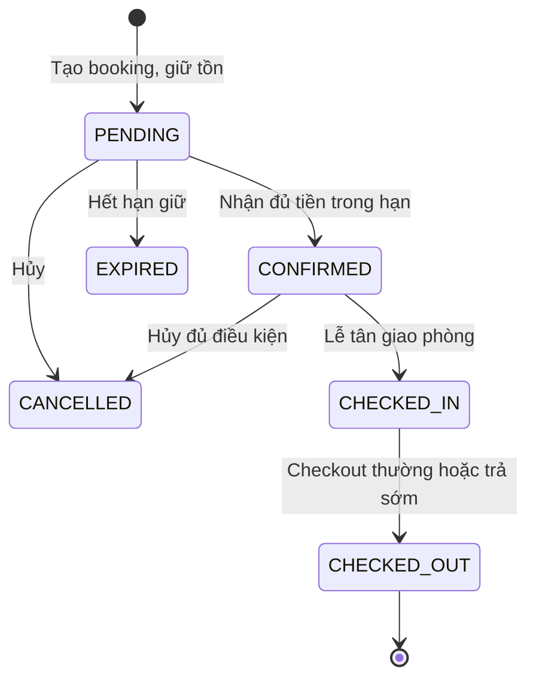

# Bộ kiểm thử web HANBAY — hướng dẫn chạy

Ngày lập: **03/11/2026**. Phạm vi: ứng dụng trong repository này, đối chiếu router, form, API, service và chính sách đang có trên nhánh `main`.

**334 ca kiểm thử, 30 nhóm chức năng, 14 quy trình xuyên suốt. Tất cả ca ban đầu là “Chưa chạy”.** Tài liệu này mô tả điều cần kiểm và kết quả mong đợi; chưa chứng nhận rằng website đã đạt mọi ca. Một ca có nhiều bộ dữ liệu phải chạy đủ từng bộ; nếu cần quản lý từng biến thể riêng, tách dòng trong bản Excel dùng cho đợt chạy đó.

Chỉ kiểm những thay đổi vừa làm: mở [16 luồng FE](stay-time-fe-checklist.md).
Tài liệu này và bộ334 ca bên dưới bao phủ toàn web; không cần chạy toàn bộ để thử riêng phần sửa.
Nguồn quy tắc/biên chính xác: [thời gian và inventory](../23-stay-time-and-inventory.md).

## 1. Mở file nào

Đặt nhiều phòng và các luồng sửa ngày 06/11/2026: [hướng dẫn kiểm tra nhóm phòng](multi-room-booking-regression.md), gồm thanh toán thiếu, QR, hoàn tiền đồng thời, hết hạn và phí trả phòng.

| File | Cách dùng |
| --- | --- |
| [Excel checklist](web-test-cases.xlsx) | File chính để chạy: có bộ lọc, cố định hàng tiêu đề, dropdown trạng thái; ghi thực tế, bằng chứng, mã lỗi. |
| [14 quy trình xuyên suốt](web-e2e-flows.md) | Hướng dẫn đi qua nhiều màn hình và đổi vai trò; có nhánh lỗi và ID ca tham chiếu. |
| [334 ca chi tiết](web-test-cases.md) | Đọc toàn văn tiền điều kiện, dữ liệu, thao tác, kỳ vọng của từng ca. |
| [CSV UTF-8 cho Excel](web-test-cases.csv) | Nhập vào công cụ quản lý kiểm thử hoặc bảng tính khác. |
| [Bảng phạm vi](web-coverage.md) | Số ca theo nhóm, loại và mức ưu tiên. |
| [Nguồn sinh checklist](build-web-test-plan.py) | Cập nhật ca và xuất lại các định dạng bằng Python standard library; không truy cập DB hay gọi website. |

Workbook có 6 sheet: `HuongDan`, `Checklist`, `MaTranQuyen`, `DuLieu`, `QuyTrinhE2E`, `PhamVi`. Các file là bản trong workspace, chưa được gửi lên hệ thống quản lý test hay phát hành ra ngoài.

## 2. Quy ước và thứ tự thực hiện

- **Happy:** dữ liệu hợp lệ, có quyền và đủ điều kiện; nghiệp vụ hoàn tất đúng.
- **Unhappy:** sai dữ liệu/quyền/trạng thái hoặc dịch vụ lỗi; hệ thống từ chối đúng và giữ dữ liệu nhất quán.
- **Biên:** ngay trước/đúng/sau mốc thời gian, số tiền, độ dài hoặc sức chứa.
- **Đồng thời:** hai phiên/request tranh cùng phòng, booking, tiền hoặc revision.
- **P0:** tiền, quyền, dữ liệu, tồn phòng và hành trình cốt lõi. Chạy trước mỗi lần phát hành liên quan nghiệp vụ.
- **P1:** chức năng chính, validation và phục hồi lỗi. Chạy trong regression đầy đủ.
- **P2:** trình bày và trường hợp ít ảnh hưởng; vẫn cần xử lý nếu cản khách thao tác.

Thứ tự đề nghị cho một đợt UAT:

1. Ghi nhận build, cấu hình và chuẩn bị dữ liệu thử.
2. Chạy `NAV`, đăng nhập cơ bản và ma trận `RBAC` để xác nhận có thể đi qua các trang đúng quyền.
3. Chạy `E2E-01` đến `E2E-14` với các fixture riêng; không chờ tới ngày lưu trú thật để chạy ca thời gian.
4. Lọc `P0` trong Checklist, chạy đủ các ca chưa được E2E bao phủ, đặc biệt callback lặp, quá hạn, tranh phòng và tính tiền.
5. Chạy các nhóm còn lại, biên dữ liệu, lỗi mạng và trình duyệt/mobile.
6. Đối soát số liệu cuối; ghi lỗi, sửa, retest ca lỗi và regression các luồng chịu ảnh hưởng.

“Mọi luồng” ở đây là phạm vi chức năng đã tìm thấy trong phiên bản hiện tại, gồm cả lỗi và nhánh biên quan trọng. Không thể liệt kê hữu hạn mọi tổ hợp dữ liệu; ma trận dữ liệu và các ca can thiệp request giúp mở rộng khi phát hiện rủi ro mới.

## 3. Môi trường và dữ liệu phải chuẩn bị

Chạy trên môi trường UAT có cùng phiên bản FE/BE và schema DB tương thích. URL local mặc định đang dùng trong dự án là FE `http://localhost:5173`, BE `http://localhost:8080`; ghi lại URL thực tế của đợt chạy. Không dùng seed thay toàn bộ inventory để chuẩn bị checklist trên DB đang có dữ liệu.

Ghi các thông tin sau vào biên bản đợt chạy:

- Commit SHA/build FE và BE, migration đã áp dụng, URL môi trường, thời gian bắt đầu/kết thúc.
- Kết quả `GET /api/v1/stay-policy`: timezone, serverNow, giờ nhận/trả, cutoff cùng ngày và cửa sổ đến muộn. Ghi cấu hình hiệu lực thay vì chỉ chụp `.env.example`.
- Mã hạng, room IDs, booking IDs/codes, payment IDs, transaction IDs, refund IDs và ticket IDs dùng cho ca. Chỉ lưu định danh thử và thông tin đã che; không ghi JWT, access token booking, reset token hoặc API key vào bằng chứng công khai.
- Cấu hình giữ phòng và rate limit của môi trường; nếu khác mặc định thì ghi rõ trước khi đánh giá các ca phụ thuộc cấu hình.

Tối thiểu cần các fixture sau; chi tiết có trong sheet `DuLieu`:

| Fixture | Chuẩn bị |
| --- | --- |
| Tài khoản | Khách A/B độc lập, một lễ tân, một buồng phòng, một quản lý, một admin. Dùng tài khoản **chỉ một role** khi kiểm quyền. Khách có `roles=[]`, không có enum `CUSTOMER`. Có thêm tài khoản LOCKED/INACTIVE để thử login. |
| Inventory | Hạng UAT-A có 3 phòng, UAT-B có 2 phòng; ghi rõ trạng thái từng phòng và booking từng đêm. Thêm khoảng chỉ còn 1 phòng cho ca cạnh tranh. |
| Booking | Pending còn hạn/hết hạn/đã nhận tiền một phần; confirmed; checked-in đến hạn/chưa đến hạn/quá hạn; checked-out/cancelled. Mỗi ca làm thay đổi trạng thái cần booking riêng. |
| Tiền | Bank sandbox hoặc webhook fixture đúng chuẩn, tài khoản ngân hàng nhận test, mã giao dịch duy nhất. Thử cả thanh toán thiếu/đủ/dư/trễ/lặp. Dùng thông tin ngân hàng nhận refund giả lập. |
| Giá | Hạng riêng giá 1.000.000đ/đêm, dịch vụ 200.000đ/đơn vị, rule cuối tuần/mùa/lễ/khuyến mãi riêng. Đây là **giá fixture**, không phải giá catalog hiện có. |
| Vận hành | Phòng DIRTY/CLEANING/OCCUPIED; ticket PENDING/IN_PROGRESS/COMPLETED; cost có revision; ticket completed chưa có chi phí. |
| File | JPEG/PNG thật, file trống, file quá 5MB/quá 25MP, file giả ảnh, 21 ảnh để thử giới hạn 20. |
| Dịch vụ ngoài | Mail test inbox, MinIO test, AI/RAG/provider test; môi trường có thể giả lập timeout/500/429. |

Các HTTP fixture tham khảo có sẵn trong [hotel-booking/http](../../hotel-booking/http): `booking.http`, `booking-history.http`, `booking-cancellation.http`, `sepay-webhook.http`, `HAN-33-payment-result.http`, `today-arrivals.http`, `dirty-rooms.http`, `room-maintenance.http`, `manager-dashboard-report.http`, `HAN-unified-ai-chat.http`, `HAN-24-room-price-search.http`. Chỉnh host/ID/biến môi trường theo UAT, không sao chép khóa thật vào tài liệu.

## 4. Ma trận truy cập cần kiểm

`✓` là được mở trang với đúng phiên; `—` là không được. Quyền mở trang vẫn phải đi cùng quyền sở hữu và điều kiện nghiệp vụ khi gọi API. Dùng cả menu, URL trực tiếp, F5 và DevTools; **ẩn nút chưa chứng minh backend đã chặn**.

| Trang / thao tác | Ẩn danh | Khách | Lễ tân | Buồng phòng | Quản lý | Admin |
| --- | --- | --- | --- | --- | --- | --- |
| Trang chủ, danh mục, chi tiết, tìm phòng | ✓ | ✓ | ✓ | ✓ | ✓ | ✓ |
| `/bookings/new`, route kết quả thanh toán | ✓* | ✓* | ✓* | ✓* | ✓* | ✓* |
| Login, register, forgot/reset | ✓ | ✓ | ✓ | ✓ | ✓ | ✓ |
| `/account/profile` | — | ✓ | ✓ | ✓ | ✓ | ✓ |
| `/account/bookings` và chi tiết mã | — | ✓* | — | — | — | — |
| `/dashboard` | — | — | — | — | ✓ | ✓ |
| `/front-desk/check-in` | — | — | ✓ | — | — | — |
| Khách đến `/front-desk/arrivals/today` | — | — | ✓ | — | ✓ | ✓ |
| Khách đang ở/trả `/front-desk/departures/today` | — | — | ✓ | — | ✓ | ✓ |
| Check-out thường và trả sớm | — | — | ✓ | — | ✓ | ✓ |
| `/housekeeping` | — | — | — | ✓ | — | — |
| `/maintenance`, URL cũ `/rooms/maintenance` | — | — | — | — | ✓ | — |
| `/management/rooms`, `/management/room-types` | — | — | — | — | ✓ | ✓ |
| `/add-on-services`, `/price-rules` | — | — | — | — | ✓ | ✓ |
| Monitor payment và danh sách webhook | — | — | — | — | ✓ | ✓ |
| Raw payload webhook | — | — | — | — | — | ✓ |
| `/payment-monitoring/refunds` và duyệt hoàn | — | — | — | — | ✓ | — |
| Gia hạn qua luồng khách | — | ✓* | —** | —** | —** | —** |
| AI chat | — | ✓ | ✓ | ✓ | ✓ | ✓ |

`*` Chỉ dữ liệu của chính tài khoản hoặc booking ẩn danh có access token hợp lệ; route công khai không cho phép xem payment bất kỳ.

`**` Service gia hạn đang yêu cầu `bookedBy` khớp người gọi; nhân viên không có quyền gia hạn thay khách chỉ nhờ role. Các trang lịch sử khách cũng chỉ cho tài khoản khách không có role nhân viên.

Đây là quyền **đang triển khai**, không phải đề xuất cấp toàn quyền cho cấp quản lý. Nếu khách sạn muốn đổi quyền, cần chốt riêng rồi sửa cả router, API và checklist.

## 5. Nguồn chuẩn để đối soát ngày, tồn và tiền

### 5.1 Ngày và giờ lưu trú

Theo cấu hình mặc định hiện tại:

| Quy tắc | Kỳ vọng |
| --- | --- |
| Múi giờ | `Asia/Ho_Chi_Minh`; ngày khách sạn từ backend. |
| Số đêm | `[checkInDate, checkOutDate)`, tối thiểu 1 đêm. 05/11 → 13/11 là **8 đêm**; đêm cuối 12/11, trả 13/11. |
| Nhận chuẩn | 14:00 ngày nhận. Trước 14:00 trong chính ngày đặt: cần lý do nhận sớm, phòng AVAILABLE và không xung đột. |
| Đặt cùng ngày | Vẫn được sau14:00 khi giờ<cutoff 23:59:59; đúng cutoff bị chặn. Ví dụ19:55 ngày 03/11 đặt03→05/11 là2đêm hợp lệ nếu còn tồn. |
| Đến muộn qua ngày | Booking nhận hôm qua, còn kỳ ở, được nhận **trước 06:00** ngày sau; đúng 06:00 không còn trong cửa sổ. Không đổi ngày đặt gốc. |
| Trả chuẩn | 12:00 ngày trả. Đúng 12:00 chưa muộn; sau 12:00 cần ghi chú xử lý. Phí do nhân viên nhập theo chính sách được duyệt, không tự cộng một đêm. |
| Khách quá hạn | Không tự checkout lúc nửa đêm/deadline. Vẫn chiếm tồn đến khi nhân viên xử lý thực tế. |
| Trả sớm | Execute chỉ với ngày thực tế là hôm nay theo khách sạn. Quote không đồng nghĩa đã checkout. |
| Thời điểm thực tế | Lưu instant UTC của nhận/trả; hiển thị theo giờ khách sạn. Dữ liệu cũ không rõ thời điểm không được suy diễn thành 14:00/12:00. |

Ca sát giờ cần **backend Clock kiểm soát trong môi trường test hoặc fixture tích hợp tương đương**. Chỉnh giờ máy khách hoặc giả `Date.now` của browser chỉ kiểm được frontend, không chứng minh backend xử lý đúng. Nếu chưa có cách đưa backend tới mốc đó thì đánh **Bị chặn**, không đánh Đạt. Không đổi giờ hệ điều hành máy đang phục vụ người dùng.

Tập mốc tối thiểu: trước/đúng/sau 14:00, 12:00, 06:00, cutoff cùng ngày, `expiredAt`, 24h và 48h trước giờ nhận; thêm chuyển tháng/năm/năm nhuận và browser khác múi giờ.

### 5.2 Số “Còn … phòng”

Phương án theo nghiệp vụ ngày lưu trú là tồn có thể bán cho **toàn bộ khoảng khách chọn**, không phải chỉ đếm phòng có trạng thái `AVAILABLE` ngay lúc này.

1. Xác định số phòng vật lý thuộc đúng hạng có thể bán; loại MAINTENANCE/OUT_OF_SERVICE theo trạng thái hiện hành.
2. Với từng đêm trong `[nhận,trả)`, trừ booking còn chiếm tồn: CONFIRMED, CHECKED_IN, PENDING **chưa tới** `expiredAt`.
3. Khách CHECKED_IN quá hạn chưa trả tiếp tục chặn tồn theo xử lý hiện tại.
4. Lấy **số nhỏ nhất của từng đêm**. Không cộng mọi booking giao nhau trên cả khoảng rồi trừ một lần.
5. Ngay trước tạo booking/gia hạn/check-in phải kiểm lại bằng backend và xử lý cạnh tranh; con số trên thẻ có thể thay đổi sau khi người khác đặt.

Ví dụ fixture 3 phòng:

| Đêm | Nguồn phòng bán được | Nhu cầu chiếm tồn | Còn |
| --- | --- | --- | --- |
| 05/11 | 3 | 2 | 1 |
| 06/11 | 3 | 1 | 2 |

Tìm 05/11 → 07/11 phải trả **còn 1 phòng**. Booking trả 07/11 không chiếm đêm 07/11. Phòng hôm nay DIRTY/CLEANING và tồn bán ngày tương lai là hai khái niệm khác nhau: khi giao chìa khóa, phòng vật lý vẫn bắt buộc AVAILABLE và không có lịch gán xung đột.

Để kết luận “đúng DB”, cần chụp cùng thời điểm: tham số ngày/khách, roomTypeId, các phòng thuộc hạng, trạng thái, các booking giao đêm và hạn giữ. API tìm phòng phải khớp bảng tính độc lập từ dữ liệu đó; so hai màn hình cùng dùng một API chưa đủ chứng minh công thức đúng. Không thể kết luận số 12/39/11/47 trong ảnh cũ còn đúng ở thời điểm khác.

### 5.3 Các phép tính tiền dùng trong fixture

- Tiền phòng bằng tổng giá snapshot của từng đêm; tiền add-on cộng theo đơn vị/số lượng của dịch vụ, không tự nhân số đêm ngoài quy định hiện có.
- Ví dụ 3 đêm x1.000.000đ +2 dịch vụ x200.000đ = **3.400.000đ**.
- Modifier cho một đêm: chọn một loại theo **HOLIDAY > WEEKEND > SEASONAL**, rồi một promotion tốt nhất trên giá sau modifier. WEEKEND là thứ bảy/chủ nhật. Ví dụ mùa +20%, promotion -10%: **1.080.000đ** từ giá gốc1.000.000đ.
- Hạn hiệu lực rule gồm hai đầu cho `stayDate`; ngày trả không phải đêm tính phí. Phần trăm theo số nguyên VND; giảm không làm giá âm.
- Tạo payment theo `max(totalAmount - paidAmount, 0)`; xác nhận ban đầu cần đủ tiền khi booking còn hợp lệ. Tiền QR gia hạn không tự thay trạng thái lưu trú.
- Checkout thường: cần thu `max(totalAmount + phí phát sinh - paidAmount, 0)`. Nợ500.000đ +phí150.000đ → thu **650.000đ**, không thu lại tiền ngân hàng đã ghi nhận.
- Trả sớm: `U` là tiền phòng của đêm chưa dùng từ ngày trả thực tế; credit=`80%U`, phí giữ=`20%U`. Với `D=max(total-paid,0)+phí phát sinh`, hoàn=`max(credit-D,0)`, thu thêm=`max(D-credit,0)` theo quy tắc làm tròn backend.
- Ví dụ `U=2.000.000`, nợ300.000, phí200.000 → credit1.600.000, refund **1.100.000đ**; add-on không nằm trong `U`.
- Hủy confirmed: còn ≥48h trước giờ nhận →100%; ≥24h và <48h →50%; <24h →từ chối theo policy hiện tại. Kiểm cả biên đúng24/48h. Refund PENDING là nghĩa vụ chờ xử lý, chưa phải tiền đã ra ngân hàng.
- Dashboard: **tiền thực nhận - refund đã hoàn thành** theo ngày giao dịch; trừ chi phí bảo trì hiện hành theo expenseDate khi hiển thị số còn lại. Không lấy tổng booking chưa thu làm tiền về; không gọi kết quả này là lợi nhuận kế toán đầy đủ.

## 6. Các quy trình xuyên suốt phải chạy

Chi tiết thao tác và ID ca tại [web-e2e-flows.md](web-e2e-flows.md) và sheet `QuyTrinhE2E`.

| ID | Luồng chính và nhánh lỗi trọng tâm |
| --- | --- |
| E2E-01 | Ẩn danh tìm→chi tiết→đặt→QR→confirmed→nhận→trả→dọn→giao khách mới; chặn nhận khi chưa đủ tiền/chưa dọn. |
| E2E-02 | Khách đăng nhập, thêm dịch vụ, thanh toán, lịch sử; đổi catalog giữ snapshot cũ; B không xem được A. |
| E2E-03 | Hai khách tranh phòng cuối, hold hết hạn, sửa không kéo dài hạn, tiền đến trễ không hồi sinh booking. |
| E2E-04 | Chuyển thiếu→đủ, callback lặp, chuyển dư; sai khóa/tài khoản/chiều tiền không được xác nhận. |
| E2E-05 | Hủy48h/24h/<24h, refund pending→đối soát→SUCCESS; chống duyệt hai lần. |
| E2E-06 | Nhận sớm, đúng 14:00, đến muộn05:59:59 và hết cửa sổ06:00; giữ ngày đặt gốc. |
| E2E-07 | Gia hạn và trả QR/thu cash tại quầy; chặn hết tồn/xung đột phòng; không thu tiền hai lần. |
| E2E-08 | Trả sớm: credit lớn hơn/bằng/nhỏ hơn nợ; chỉ ngày hôm nay; chống refund/thu trùng. |
| E2E-09 | Khách quá hạn vẫn chặn tồn, trả muộn có ghi chú, dọn xong mới nhận khách tiếp. |
| E2E-10 | Bảo trì→chi phí→revision cạnh tranh→hoàn tất→dashboard/history. |
| E2E-11 | Quản trị hạng/phòng/ảnh/dịch vụ/rule/lễ→giá khách→snapshot→chặn xóa có lịch sử. |
| E2E-12 | Đăng ký→hồ sơ→reset một lần→ma trận quyền→logout/đổi tài khoản không rò dữ liệu. |
| E2E-13 | AI hỏi policy→action điều hướng→backend kiểm lại; lỗi provider/SSE; không lộ booking B. |
| E2E-14 | Hai phiên tranh dữ liệu và mất phản hồi sau commit; đọc lại trạng thái, không double-charge/refund/assign. |

Vòng đời dùng để kiểm chéo sau mỗi bước:



Phòng vật lý: `AVAILABLE → OCCUPIED → DIRTY → CLEANING → AVAILABLE`; bảo trì qua ticket: `AVAILABLE → MAINTENANCE → AVAILABLE`. Gia hạn giữ nguyên trạng thái confirmed/checked-in. Callback thanh toán không được tự nhận hoặc tự trả phòng.

## 7. Cách ghi kết quả và báo lỗi

Lưu bản Excel theo build/ngày trước khi điền, ví dụ `HANBAY-UAT-<build>-<ngày>.xlsx`. Tệp mẫu vẫn giữ nguyên để dùng cho đợt sau.

Mỗi dòng có: ID, tên ca, nhóm, loại, ưu tiên, vai trò, trang, chuẩn bị chung, dữ liệu riêng, thao tác, mong đợi, cách chạy, trạng thái, thực tế, bằng chứng, mã lỗi.

| Trạng thái | Khi dùng |
| --- | --- |
| Chưa chạy | Chưa thực hiện hoặc chưa đủ bằng chứng để kết luận. |
| Đạt | Đã chạy đủ mẫu dữ liệu của ca, đối soát trạng thái và tiền/tồn khi liên quan. |
| Lỗi | Thực tế khác kỳ vọng; có bước tái hiện và định danh fixture. |
| Bị chặn | Thiếu tài khoản/fixture/test clock/dịch vụ test hoặc một lỗi trước đó ngăn chạy. Ghi rõ cần ai/cái gì để mở chặn. |
| Không áp dụng | Chỉ khi có lý do phạm vi được ghi nhận; không dùng để bỏ qua lỗi hoặc thiếu môi trường. |

Mẫu ghi lỗi:

```text
Build / môi trường:
Case ID và mẫu dữ liệu lỗi:
Vai trò / browser / giờ server / policy:
roomTypeId / roomId / bookingCode / paymentId / ticketId liên quan:
Các bước tái hiện:
Kết quả mong đợi:
Kết quả thực tế:
Trạng thái trước/sau và số tiền/tồn trước/sau:
Bằng chứng: ảnh, video, request/response đã che token/PII, mã tương quan log:
Mức ảnh hưởng và mã issue:
Retest trên build nào, kết quả:
```

Với concurrency, lưu cả hai phiên và thời điểm request; với payment, lưu transactionId duy nhất và số tiền từng lần; với thời gian, lưu backend instant/policy. Chỉ ảnh một toast “thành công” chưa đủ kết luận ca tiền/phòng đạt.

Điều kiện kết thúc một đợt: toàn bộ ca thuộc phạm vi có trạng thái; không còn lỗi P0 mở; mọi ca bị chặn có người xử lý và quyết định ghi nhận; booking/phòng/payment/refund/dashboard đã đối soát; các ca lỗi đã retest và các luồng liên quan đã regression. Không lấy tỷ lệ Đạt cao để che một lỗi double refund hoặc overbooking.

## 8. Giới hạn hiện tại và các điểm cần ghi nhận riêng

Các mục dưới đây không được ghi như tính năng đã có hoặc ca đã đạt:

1. **Hoàn tiền là quy trình đối soát thủ công.** Tạo refund không thực hiện chuyển khoản ra ngân hàng; manager chỉ xác nhận sau khi đối soát giao dịch ngoài hệ thống. Không có callback hoàn tự động để giả định.
2. **Pending đã trả một phần rồi hủy cần đối soát.** Luồng hủy hiện tại chưa tự bảo đảm hoàn khoản partial này; ca `CANCEL-002` phải phản ánh giới hạn, không báo khách “đã nhận lại tiền”.
3. **Hủy booking gia hạn/nhiều payment cần kiểm thêm.** Công thức hủy hiện dùng totalAmount và giao dịch đủ điều kiện; phải phát hiện nếu số hoàn vượt tiền thực nhận hoặc bị gắn sai payment. Chưa chứng nhận toàn bộ tổ hợp tài chính này đạt.
4. **Bảo trì hiện có hiệu lực theo trạng thái phòng**, chưa có lịch khóa phòng theo khoảng ngày tương lai trong UI. Không dựng ca “đặt lịch bảo trì tháng sau” như nút đang tồn tại.
5. **Thu tiền mặt gắn checkout**, không suy diễn có luồng tạo booking chưa trả tiền rồi check-in ngay hoặc thu mọi khoản qua POS.
6. Chưa có luồng riêng cho thuê theo giờ/day-use, tự tính mọi phí late checkout, tự no-show/cancel/checkout theo đồng hồ, hoặc tự chuyển phòng khi gia hạn xung đột.
7. Chưa tìm thấy UI quản trị tài khoản nhân viên, CRUD tiện nghi độc lập, xuất báo cáo dashboard hoặc nút reprocess webhook. Không đưa các thao tác đó vào happy path hiện có.
8. Mật khẩu đăng ký đang kiểm độ dài8–72 và xác nhận khớp; không đánh lỗi chỉ vì mật khẩu thiếu chữ hoa/số khi policy chưa bắt buộc. Nếu thông điệp UI diễn đạt khác validation, ghi vấn đề thống nhất nội dung.
9. Một số kỳ vọng bảo mật, idempotency, cache và phục hồi lỗi là **điều phải kiểm**. Việc có ca trong checklist không chứng minh đã triển khai đủ mọi biện pháp đó.

## 9. Cơ sở đối chiếu trong mã nguồn

Ưu tiên mã hiện tại và policy, không dùng tài liệu cũ để suy diễn tính năng chưa có:

- Điều hướng và quyền: [router](../../client/src/app/router.tsx), [route access](../../client/src/routes/route-access.ts), [security config](../../hotel-booking/src/main/java/com/hanbay/hotel/common/config/SecurityConfig.java).
- Chính sách ngày giờ: [HotelStayPolicy](../../hotel-booking/src/main/java/com/hanbay/hotel/booking/policy/HotelStayPolicy.java), [frontend hotel-time](../../client/src/utils/hotel-time.ts), [báo cáo triển khai](../reports/2026-11-03-stay-time-implementation.md).
- Tồn phòng: [RoomAvailabilityCalculator](../../hotel-booking/src/main/java/com/hanbay/hotel/room/service/RoomAvailabilityCalculator.java), [search service](../../hotel-booking/src/main/java/com/hanbay/hotel/room/service/AvailableRoomTypeSearchService.java).
- Giá và gia hạn/trả sớm: [PricingServiceImpl](../../hotel-booking/src/main/java/com/hanbay/hotel/pricing/service/impl/PricingServiceImpl.java), [StayModificationServiceImpl](../../hotel-booking/src/main/java/com/hanbay/hotel/booking/service/impl/StayModificationServiceImpl.java).
- Các policy: [booking](../knowledge-base/booking-policy.md), [payment](../knowledge-base/payment-policy.md), [cancellation](../knowledge-base/cancellation-policy.md), [stay modification](../knowledge-base/stay-modification-policy.md), [check-in](../knowledge-base/check-in-policy.md), [check-out](../knowledge-base/check-out-policy.md), [housekeeping](../knowledge-base/housekeeping-policy.md), [add-on](../knowledge-base/add-on-policy.md), [room](../knowledge-base/room-policy.md).
- Rate limit và dòng tiền: [login rate limiting](../22-login-rate-limiting.md), [financial reporting & maintenance](../financial-reporting-and-maintenance.md).

Sinh lại bộ file sau khi cập nhật nguồn ca:

```sh
python3 docs/testing/build-web-test-plan.py
```

Nếu đầu ra đã tồn tại, script từ chối ghi đè. Chỉ dùng `--force` sau khi đã lưu bản kết quả chạy ở nơi khác; lệnh này đưa các file sinh tự động về trạng thái ban đầu **Chưa chạy**. File hướng dẫn này không bị ghi đè.

## 10. Kết luận đúng cho ca19:55 sau giờ nhận

14:00 bắt đầu nhận,23:59:59 dừng đặt cùng ngày, expiredAt là hạn trả tiền của hold,
12:00 ngày trả là giờ trả chuẩn. Cho đặt03→05/11 lúc 19:55 là kỳ vọng đúng của TIME-006/FE-05,
không ghi lỗi vì đã qua14:00. Phải kiểm tiếp đủ tiền trong hạn, confirmed và giao phòng sẵn sàng;
ảnh pending chưa chứng minh đã thanh toán/check-in. Giữ nguyên trạng thái334 ca Chưa chạy khi chưa thực hiện.
